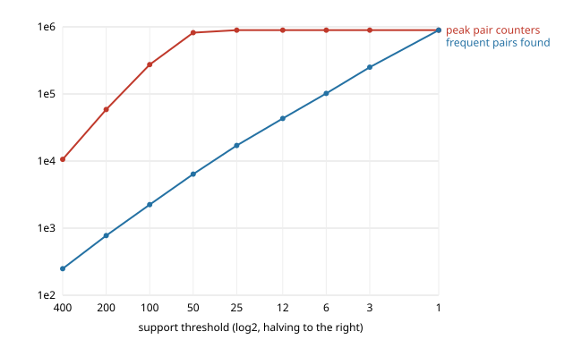

# Task 2 · Explosion curve

Data: `bench.build()` — 20,000 baskets, 2,000 items, Zipf-popular, fixed seed.
Algorithm: `PlainApriori` (pass one drops infrequent items, pass two counts every pair of survivors).
Raw numbers: `explosion.json`. Times and memory were measured under `tracemalloc`, which slows Python down,
so seconds are about 3× what `bench.py` shows for the same support.

## A6 · Machine

| | |
|---|---|
| CPU | AMD Ryzen 5 7430U (6 cores / 12 threads), `AMD64 Family 25 Model 80` |
| RAM | 13.8 GB total, about 2.0 GB free when measured |
| OS / Python | Windows 11 (10.0.26200), Python 3.14.6 |
| Also running | the Claude desktop app and normal background apps; nothing else heavy |

## A3 · Peak counters against support

| support | frequent items | frequent pairs | peak counters | counters / answer | seconds | peak memory |
|---:|---:|---:|---:|---:|---:|---:|
| 400 | 146 | 249 | 10,585 | 42.5 | 1.38 | 1.1 MB |
| 200 | 345 | 776 | 58,626 | 75.5 | 2.26 | 6.7 MB |
| 100 | 825 | 2,244 | 273,701 | 122.0 | 4.84 | 28.6 MB |
| 50 | 1,849 | 6,397 | 820,259 | 128.2 | 7.02 | 107.7 MB |
| 25 | 2,000 | 17,045 | 893,456 | 52.4 | 9.04 | 107.7 MB |
| 12 | 2,000 | 43,116 | 893,456 | 20.7 | 8.88 | 110.0 MB |
| 6 | 2,000 | 101,938 | 893,456 | 8.8 | 9.33 | 126.5 MB |
| 3 | 2,000 | 250,054 | 893,456 | 3.6 | 9.85 | 163.9 MB |
| 1 | 2,000 | 893,456 | 893,456 | 1.0 | 12.47 | 334.2 MB |

Supports used span 400 → 1, a 400× range (A1).

Both axes are logarithmic (support in halvings, counts in powers of ten). `plot_explosion.py` draws it from `explosion.json`.

## A2 · Where it broke

**It did not break on this machine.** I halved all the way down to support 1 (every pair that ever occurs counts as frequent),
and the worst run took 12.5 s and 334 MB, well inside the ~2 GB that was free. The thing that grew the most was time
(1.4 s → 12.5 s) and then memory (1 MB → 334 MB); nothing ran out.

The reason is in the counter column: it stops at **893,456** from support 25 down. At support 25 all 2,000 items are
frequent, so pass one filters nothing, and pass two counts every pair that occurs in at least one basket. On this data
that number is fixed, so lower supports cannot add counters — only the dictionary of *answers* keeps growing
(memory 108 MB → 334 MB is mostly the result dict at support 3 and 1). The ceiling is a property of the data set
(20,000 baskets of ~20 items), not of my laptop. With more baskets or more items the same curve would keep climbing.

## A4 · How fast counters grow

| halving | 400→200 | 200→100 | 100→50 | 50→25 | 25→12 and below |
|---|---:|---:|---:|---:|---:|
| counters × | 5.5 | 4.7 | 3.0 | 1.09 | 1.00 |
| frequent pairs × | 3.1 | 2.9 | 2.9 | 2.7 | 2.4 – 2.5 |

While pass one is still filtering (400 → 50), counters grow **3 to 5.5× per halving — much worse than doubling**.
Halving support roughly 2.3× the number of frequent items (146 → 345 → 825 → 1,849), and the pairs among them grow
with the square of that. Once every item is frequent (support ≤ 25) the counter count is saturated.

## A5 · Answers grow differently from counters

Frequent pairs grow at a steady ~2.5–3× per halving the whole way down. Counters grow faster than that while
support is high: from 400 to 50, answers grew 26× (249 → 6,397) but counters grew 77× (10,585 → 820,259), so the
number of counters spent per answer went from 42 to 128. At support 50, 99.2% of the counters held in pass two were
for pairs that turned out *not* to be frequent.

That gap is the whole problem: asking for "a slightly lower threshold" costs far more memory than the extra
answers it returns, because pass two must keep a counter for every *candidate*, and the candidates are built
from frequent items, which are exactly the items that co-occur all the time. §6.3 (PCY, Task 3) attacks
exactly this gap — it shrinks the candidate set, not the answer set. (Below support 25 the ratio falls again only
because this data set runs out of distinct pairs; that is a ceiling, not an improvement.)
